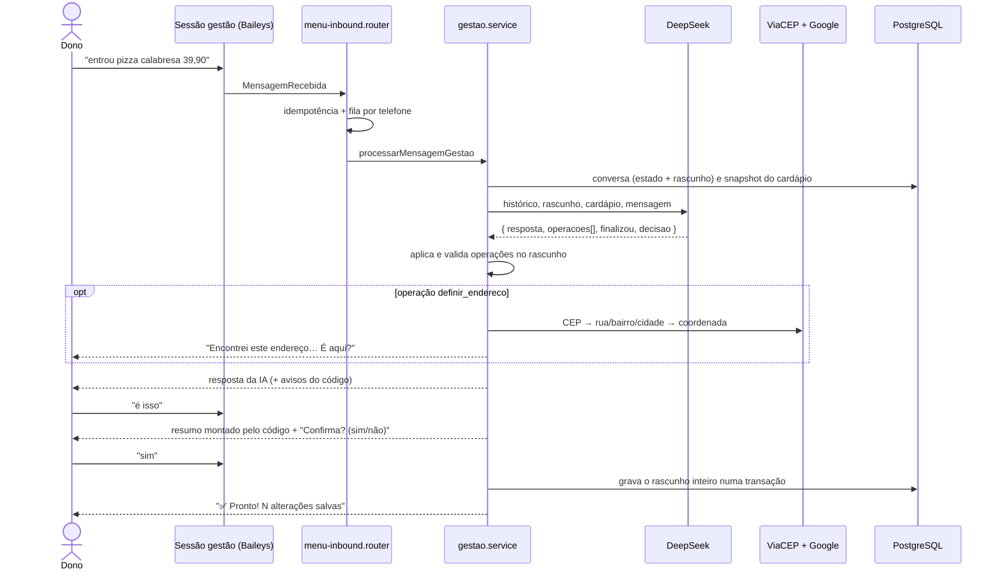
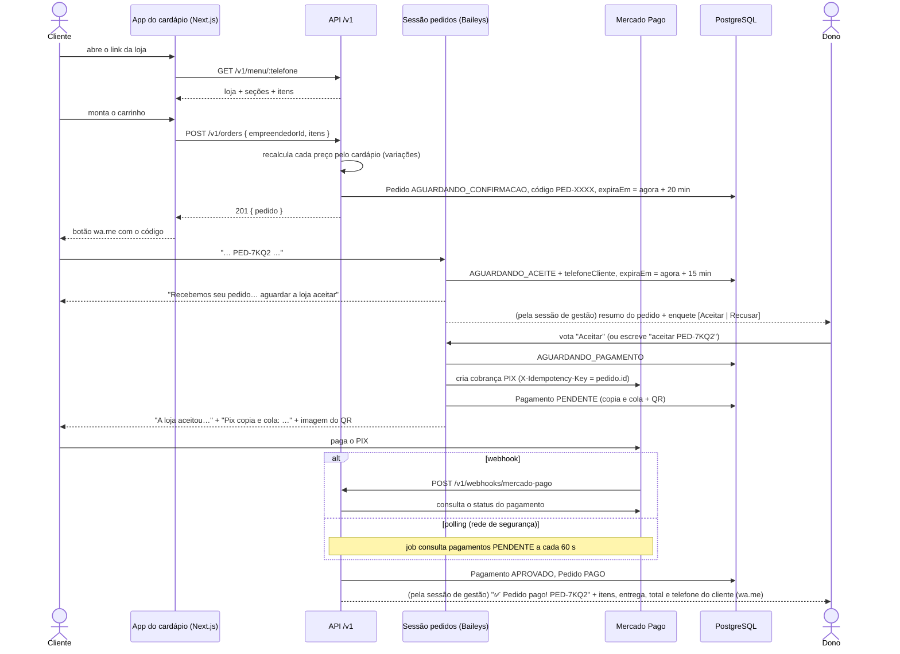

# Fluxos do zapmenu-back

> Referência de como o backend funciona hoje, escrita a partir do código (2026-10-16).
> Detalhes da conversa de gestão (IA, rascunho, operações, endereço e entrega) estão em [`plano-gestao-conversacional.md`](plano-gestao-conversacional.md). As telas do app do cliente estão em `../../docs/frontend-plano.md` (pasta `zapmenu/docs/`, fora deste repositório).

## Sumário

1. [Visão geral](#1-visão-geral)
2. [Identidade: quem é quem](#2-identidade-quem-é-quem)
3. [Fluxo 1 — Gestão do cardápio pelo WhatsApp](#3-fluxo-1--gestão-do-cardápio-pelo-whatsapp)
4. [Fluxo 2 — Compra do cliente](#4-fluxo-2--compra-do-cliente)
5. [Ciclo de vida do pedido e do pagamento](#5-ciclo-de-vida-do-pedido-e-do-pagamento)
6. [Jobs de fundo](#6-jobs-de-fundo)
7. [Sessões do WhatsApp](#7-sessões-do-whatsapp)
8. [API HTTP](#8-api-http)
9. [Idempotência e confiabilidade](#9-idempotência-e-confiabilidade)
10. [Integrações externas](#10-integrações-externas)
11. [Lacunas conhecidas](#11-lacunas-conhecidas)

---

## 1. Visão geral

O produto tem **dois números de WhatsApp** e um **app web de cardápio**. Um único processo Node sobe tudo:

```
                    ┌───────────────────────── processo Node (src/main.ts) ─────────────────────────┐
 Dono da loja ──────┤▶ sessão WhatsApp "gestão"  ── router de gestão ── IA (DeepSeek) ── rascunho   │
  (WhatsApp)        │                                                    └─ ViaCEP + Google (endereço)│
                    │                                                                                │
 Cliente ───────────┤▶ API HTTP Fastify /v1  ── cardápio público, criar pedido                      │
  (app web)         │                                                                                │
 Cliente ───────────┤▶ sessão WhatsApp "pedidos" ── router de pedidos ── cobrança PIX (Mercado Pago) │
  (WhatsApp)        │                                                                                │
 Mercado Pago ──────┤▶ POST /v1/webhooks/mercado-pago ─┐                                             │
                    │  job de polling de pagamentos ───┴─▶ pedido PAGO ─▶ aviso ao dono (sessão gestão)│
                    │  job de expiração de pedidos                                                  │
                    └──────────────────────────────── PostgreSQL (Prisma) ─────────────────────────┘
```

| Peça | Arquivo | Papel |
|---|---|---|
| Bootstrap | `src/main.ts` | Lê o `.env`, cria repositórios e clientes externos, sobe as sessões do WhatsApp, a API e os jobs |
| Gestão | `src/menu/gestao/` | Conversa com o dono, rascunho de alterações, gravação em transação |
| Cardápio | `src/menu/` | Leitura do cardápio público, cálculo de preço com variações, cálculo de entrega |
| Endereço | `src/menu/endereco/` | CEP (ViaCEP) e coordenada (Google Geocoding) |
| Pedidos | `src/orders/` | Criação, código `PED-XXXX`, transições de status, expiração |
| Pagamentos | `src/payments/` | Cobrança PIX, webhook, polling |
| WhatsApp | `src/whatsapp/` | Interface `WhatsAppClient`, implementação Baileys, routers das duas sessões |
| HTTP | `src/http/` | Fastify, CORS, tratamento de erros, rotas `/v1` |

O processo **precisa ficar rodando** (não é serverless): o Baileys mantém uma conexão aberta com o WhatsApp para cada número.

---

## 2. Identidade: quem é quem

| Quem | Identificado por | Onde |
|---|---|---|
| Dono da loja (`Empreendedor`) | **Telefone** de quem escreve no número de gestão | O port `CadastroEmpreendedores` (`src/menu/gestao/cadastro-empreendedores.ts`) diz se o número tem acesso e devolve o próprio telefone como id; hoje é a lista `GESTAO_TELEFONES_PERMITIDOS` (vazia = qualquer número). Os repositórios fazem *upsert* de `Empreendedor` e `Cardapio` por telefone |
| Loja no cardápio público | O mesmo telefone, na URL: `GET /v1/menu/:telefone` | `menu.repository.prisma.ts` |
| Cliente final | Telefone de quem manda o código no número de pedidos | Gravado em `Pedido.telefoneCliente` na confirmação |

Consequências que valem saber:
- **Qualquer pessoa que escrever no número de gestão vira um empreendedor** com cardápio próprio. Não existe cadastro, convite nem lista de permitidos (fora do modo autoteste, seção 7).
- **Consultar o cardápio de um telefone que não existe também cria o empreendedor** (o `GET /v1/menu` faz *upsert*). Ver lacuna L2.
- O WhatsApp às vezes identifica contas novas por `@lid` em vez do telefone; o cliente Baileys converte para o telefone real antes de qualquer regra (`telefoneDoChat`).

---

## 3. Fluxo 1 — Gestão do cardápio pelo WhatsApp

Resumo. O detalhamento completo (prompt, formato da IA, operações, proteções) está em [`plano-gestao-conversacional.md`](plano-gestao-conversacional.md).



### Estados da conversa

```
OCIOSO ──mensagem──▶ CONVERSANDO ──IA percebe "terminei" e nada falta──▶ CONFIRMANDO
                         ▲                                                   │
                         └──────────── "não" / nova alteração ◀──────────────┤
OCIOSO ◀──── "sim" (grava numa transação) ◀──────────────────────────────────┘
"cancelar" em qualquer etapa → descarta o rascunho → OCIOSO
```

Guardado em `EstadoConversa` (`estado` + `contexto` JSON com rascunho, histórico, foto pendente, endereço em andamento e endereço pendente).

### Prévia em imagem

Quando a IA finaliza e o resumo vai ser mostrado, a gestão monta a prévia do rascunho (`menu/gestao/previa.ts`: itens novos e editados com os valores finais e, se a loja mudou, o cabeçalho), guarda em `PreviaGestao` por 1 h e manda **antes do resumo** a imagem `FRONTEND_URL_INTERNA/api/previa/<id>` com a legenda "Assim vai ficar no cardápio 👇". O front desenha o PNG com Satori (`next/og`) no visual do app, buscando os dados em `GET /v1/previas/:id`. A prévia nunca segura o resumo: se não der para guardar, ou se a imagem falhar ou passar de 8 s, vai só o texto. Pausar, reativar, remover e mudar só a categoria não geram prévia. O comando *como vai ficar?* (sem IA) manda a prévia do rascunho atual a qualquer momento. A imagem mostra até 4 itens; o resto vira "+N alterações no resumo abaixo".

### Cadastro da loja

- **Obrigatórios** para a loja entrar no ar (`menu/cadastro-da-loja.ts`): nome, link (sai do nome se não for escolhido), como entrega, endereço confirmado, taxas por distância (só se entrega) e horário de funcionamento. Os itens do cardápio ficam de fora: são cadastrados depois, na conversa.
- Enquanto faltar algum, o começo de cada conversa mostra a lista com ✅/⬜ e o progresso ("3 de 6"), e a IA recebe `cadastro_pendente` para pedir o próximo dado, um de cada vez. O comando *o que falta* mostra a lista a qualquer momento (sem chamar a IA).
- Loja incompleta: o cardápio público vem com `loja.emMontagem: true` (o app mostra "terminando o cadastro") e `POST /v1/orders` recusa com `LOJA_EM_MONTAGEM`.
- Ao salvar o último obrigatório: "🎉 Sua loja está no ar!" com o link do cardápio (`FRONTEND_ALLOWED_ORIGIN/<slug>`), o pedido dos itens e a lista dos opcionais.
- **Opcionais:** descrição, logo e capa (foto mandada na conversa dizendo que é o logo/a capa), cor e pedido mínimo; e o pagamento na entrega (liga/desliga, padrão ligado). Lembrete no começo de uma conversa no máximo 1 vez por semana (`Loja.lembreteOpcionaisEm`), até completar ou a loja responder *não lembrar mais* (`Loja.naoLembrarOpcionais`).

### Planos e assinatura

Catálogo único em `planos/domain/catalogo.ts` (preço em centavos, limites e recursos). Hoje são dois planos:

| | Básico (`ESSENCIAL`) | Profissional (`PROFISSIONAL`) |
|---|---|---|
| Preço | R$ 29,99/mês ou R$ 24,99/mês no anual | R$ 59,99/mês ou R$ 49,99/mês no anual |
| Pedidos por mês | 100 | 1.500 |
| Produtos | 30 | ilimitados |
| Entrega | taxa fixa (valor único, raio opcional) | taxa fixa ou por distância (a loja escolhe) |
| Recursos pagos (entrega por distância, cor e capa, prévia em imagem, sem selo…) | nenhum | todos |

- **Teste:** a primeira conversa de uma loja sem assinatura grava `Assinatura` em `TESTE` por 14 dias, com tudo do Profissional. Lojas anteriores aos planos ganharam o teste na migração.
- **Na gestão** (`menu/gestao/permissoes-por-plano.ts`, no molde do filtro por tipo): o que o plano não inclui sai das operações da IA e o bot responde "🔒 Isso faz parte do plano *Profissional*" com o link dos planos (`FRONTEND_URL_PUBLICA/#planos`) e o comando *assinar profissional*. Produto acima do limite é recusado com a explicação do upgrade. Sem prévia em imagem no Básico.
- **Na vitrine** (`menu/plano-na-vitrine.ts`): cor, capa e entrega por distância somem fora do plano (nada é apagado), `loja.mostrarSelo` liga o rodapé "Feito com ZapMenu" e a loja `SUSPENSA` vem com `loja.indisponivel: true` e sem o catálogo; `POST /v1/orders` recusa com `LOJA_INDISPONIVEL`.
- **Limite de pedidos:** o cliente nunca é barrado. A cada venda (pedido que chega a `PAGO` ou `CONFIRMADO`, contado por `confirmadoEm` no mês do fuso da loja) a loja recebe na gestão, uma vez por mês cada, o aviso de 80% e de 100% com o convite para o upgrade.
- **Comandos (sem IA):** *meu plano* (plano, situação, pedidos do mês e produtos), *assinar [básico|profissional] [anual]* (pede o e-mail da conta do Mercado Pago na primeira vez e manda o link para cadastrar o cartão; no teste, a primeira cobrança fica para o fim do teste), *mudar de plano* / *mudar para o básico* (upgrade vale na hora; downgrade na próxima cobrança; os dois mudam o valor da assinatura no Mercado Pago), *cancelar assinatura* (com confirmação; vale até o fim do período pago) e *regularizar* (assina de novo o plano que a loja tinha). Com a loja suspensa, a gestão só aceita esses comandos.

```
TESTE ──cartão autorizado──▶ ATIVA ──cobrança recusada──▶ PENDENTE ──5 dias──▶ SUSPENSA
  │                           ▲  │                           │                    │
  └──14 dias sem assinar──▶ SUSPENSA   └──cancelar──▶ CANCELADA ──fim do período──▶ SUSPENSA
                              └────── cobrança aprovada / regularizar ◀────────────┘
```

### Mensagens seguidas, áudio, descrições e fotos da loja

- **Mensagens seguidas** (`whatsapp/menu-session/agrupador.ts`, todos os planos): a gestão espera 3 s de silêncio por telefone (reinicia a cada mensagem, teto de 10 s, com "digitando...") e manda tudo numa rodada só para a IA; a primeira foto vai junto (as outras logo depois). Comandos sem IA sozinhos (sim, cancelar, o que falta, meu plano…) e mensagens com `PED-XXXX` respondem na hora. Todos os ids são marcados como processados juntos. O prompt não cria item sem nome específico.
- **Áudio** (`audio/`, Profissional, cota `minutosAudioMes`): nota de voz do lojista na gestão e do cliente no número de pedidos é transcrita (porta `Transcritor`, adaptador para APIs compatíveis com a OpenAI: OpenAI ou Groq) e segue como texto; na gestão a resposta começa com "🎤 Entendi: …". Até 2 min por áudio e 15 s de espera; senão "Não consegui ouvir o áudio, pode escrever?". O áudio do cliente conta na cota da loja do pedido mais recente dele. O áudio não é guardado; o uso fica em `UsoDeCota` (segundos). Sem `TRANSCRICAO_API_KEY`, o bot pede para escrever.
- **Descrições com IA** (Profissional, cota `sugestoesIaMes`): depois de salvar itens novos sem descrição (ou com menos de 40 caracteres), o bot oferece escrever; também *melhora a descrição da X* e *melhora as descrições da categoria Y* (até 10 por vez). O DeepSeek dá 2 opções de até 200 caracteres no tom do segmento, sem inventar ingrediente, material, tamanho ou origem e sem promessas; a pessoa responde 1, 2, escreve a sua ou *pular*. Nada é salvo sem a escolha.
- **Capa e logo**: foto com legenda curta "essa é a capa"/"esse é o logo" vai direto; foto sem legenda, sem item esperando foto (e não logo depois de uma foto de item), pergunta numa enquete se é item, capa ou logo. A capa é recortada em 1200×400 e o logo em 400×400, com menos de 300 KB (`menu/imagens/`, sharp); o resumo mostra a prévia do topo e pede o "sim". *Tirar a capa* / *tirar o logo* também passam pelo resumo. O logo vale em todos os planos; a capa é do Profissional. **Pendência:** as fotos ainda ficam em base64 no banco, como as dos itens (lacuna L12).

### Promoções e descontos (Profissional)

- **Criar:** a IA lê "toda quarta e quinta a calabresa sai por 39,90" ou "10% em todas as pizzas até domingo" como `nova_promocao` (preço fixo só para itens; percentual de 1% a 90% para itens, categorias ou a loja toda; dias da semana, horário e data final opcionais). A promoção **não entra no rascunho**: o código valida, mostra o resumo com quantos itens são afetados e 2 ou 3 exemplos (`Calabresa ~R$ 50,00~ → R$ 45,00`), manda a prévia em imagem com o preço riscado e só grava depois do "sim" (duas vezes acima de 50%). Tabelas `Promocao` e `PromocaoAlvo` (sem alvo = loja toda).
- **Valer:** a leitura do cardápio (`menu/promocoes-na-vitrine.ts`) aplica a promoção que vale agora no fuso da loja e devolve `item.promocao` (`rotulo` "Promoção de quarta"/"-10%" e `precoPromocional`). O preço do pedido sai da mesma leitura, no momento da criação; as variações somam o acréscimo normal; com mais de uma, vale a de menor preço, sem acumular; o percentual arredonda para baixo no centavo. O `precoBase` nunca muda.
- **Comandos (sem IA):** *minhas promoções*, *pausar/reativar/remover promoção N*.
- **Fim:** o job das promoções desliga a vencida e, no dia seguinte ao fim (8h no fuso da loja), avisa o lojista uma vez (`Promocao.avisoFimEm`).
- **Plano:** preço fixo é `PROMOCOES` e percentual é `DESCONTO_PERCENTUAL`. Fora do plano, a IA não cria (convite para o Profissional) e as promoções gravadas ficam guardadas sem valer.

### Relatório de vendas (Profissional)

- **Na hora:** *relatório* (últimos 7 dias), *relatório do mês* (do dia 1 até agora), *vendas de hoje* e *vendas de ontem*, sempre comparados com o período anterior de mesmo tamanho (▲/▼ %).
- **Automático:** semanal na segunda às 9h (segunda a domingo anteriores) e diário às 8h (ontem), no fuso da loja. O diário desliga com *parar relatório diário* (e volta com *voltar relatório diário*). `RelatorioEnviado` (loja, tipo, período) impede mandar duas vezes.
- **Conteúdo:** total vendido, pedidos, ticket médio, os 5 mais vendidos, entrega/retirada/Correios, PIX/cartão/dinheiro na entrega, horário de pico. Só pedidos pagos ou confirmados (e o que veio depois). Período sem vendas: mensagem curta.

### Regras principais

| Regra | Comportamento |
|---|---|
| Quem grava | Só o código, depois do "sim" no resumo. A IA só propõe operações. |
| Palavras-chave sem IA | `cancelar`, `cardápio` (e variações como "me mostra o cardápio"), `sim`/`não` no resumo e na confirmação de endereço (`comandos.ts`) |
| Resumo | Montado pelo código a partir do rascunho: o que a pessoa confirma é exatamente o que será salvo |
| Pendências | Item novo sem nome ou preço, endereço esperando confirmação, entrega ligada sem endereço ou sem faixas: o bot pergunta em vez de mostrar o resumo |
| Rascunho parado | Mais de 30 min: o bot relembra o que está pendente. Mais de 24 h: descarta e avisa. |
| Memória da IA | Últimas 20 mensagens, cada uma cortada em 500 caracteres |
| IA fora do ar | Rascunho preservado; o bot pede para repetir. Sem `DEEPSEEK_API_KEY`, só as palavras-chave funcionam. |
| Fotos | Baixadas do WhatsApp como data URI base64 e guardadas em `ItemCardapio.imagemUrl` |
| Endereço da loja | CEP + número digitados → ViaCEP → Google → "É aqui?" → só entra no rascunho depois do "sim". Sem `GOOGLE_MAPS_API_KEY`, o bot avisa que está indisponível. |
| Entrega | Dois jeitos (`Loja.modoEntrega`): **taxa fixa** (`taxaEntrega`, com raio opcional `raioEntregaKm`; todos os planos) ou **por distância** (faixas "até X km → R$ Y", até 6 faixas e 30 km; só Profissional). Um valor só vira taxa fixa; faixas viram distância. Fora do Profissional vale sempre a taxa fixa (`menu/entrega.ts` → `entregaEmUso`): a loja que usava distância e caiu para o Básico passa para a taxa fixa e, sem valor informado, fica só com retirada até responder; o bot avisa no começo da conversa e quando o plano muda. Nada é apagado. |

---

## 4. Fluxo 2 — Compra do cliente



### Passo a passo

1. **Cardápio.** `GET /v1/menu/:telefone` devolve a loja, as seções (categorias na ordem de criação, "Outros" por último, sem seções vazias) e só os itens ativos e não removidos.
2. **Pedido.** `POST /v1/orders` valida o carrinho com zod, confere se cada item ainda está no cardápio e **recalcula o preço no servidor** (`calcularPrecoUnitario`: preço base + adicional da opção escolhida em cada variação; toda variação é obrigatória). O `precoUnitario` enviado pelo cliente é ignorado. Gera um código `PED-` + 4 caracteres (alfabeto sem `I`, `O`, `0`, `1`; até 5 tentativas para achar um livre).
3. **Código no WhatsApp.** O router de pedidos procura `PED-XXXX` em qualquer posição da mensagem (sem diferenciar maiúsculas). Se achar e o pedido estiver em `AGUARDANDO_CONFIRMACAO` e dentro do prazo, passa para `AGUARDANDO_ACEITE`, grava o telefone do cliente e dá à loja `PEDIDO_ACEITE_MINUTOS` (padrão 15) para responder.
4. **Aceite da loja.** `pedirAceiteDaLoja` manda ao dono, pela sessão de gestão, o resumo (itens com variações e observações, cliente, entrega ou retirada, total) e uma enquete **Aceitar / Recusar**; o id da enquete fica em `Pedido.enqueteAceiteId`. O voto chega cifrado: a enquete é enviada com um segredo nosso, guardado em `EnqueteWhatsApp`, e `whatsapp/baileys/enquete.ts` decifra o voto (tentando o JID de telefone e o LID). Se a enquete não aparecer, o dono pode escrever `aceitar PED-XXXX` / `recusar PED-XXXX`. Só o dono da loja do pedido decide, só enquanto o pedido aguarda o aceite, e só a primeira decisão vale (`decidirPedido`).
5. **Pagamento na entrega.** Se o cliente escolheu dinheiro ou cartão (`formaPagamento`; a loja precisa ter `aceitaPagamentoNaEntrega`, ligado por padrão), o aceite leva o pedido direto para `CONFIRMADO`, sem PIX, e o cliente recebe como e quanto pagar ("Dinheiro na entrega (troco para R$ 150.00)"). O resumo da loja mostra a forma de pagamento.
6. **Cobrança PIX.** No aceite de um pedido com PIX, o PIX é gerado **antes** de avisar o cliente. Se o Mercado Pago falhar, a loja recebe "aceito, mas o PIX não saiu agora", o cliente recebe "o PIX está demorando" e um job (no ritmo do polling) tenta de novo os pedidos em `AGUARDANDO_PAGAMENTO` sem cobrança, mandando o PIX quando sair (`whatsapp/orders-session/pix-pendente.ts`). Falha ao enviar mensagem não desfaz o aceite: a loja é avisada de que o cliente não recebeu. Depois disso, `criarGeradorCobranca` cria a cobrança no Mercado Pago só se o pedido ainda não tiver pagamento; o cliente recebe o copia e cola e, se houver, a imagem do QR. Na recusa o pedido vira `RECUSADO` e o cliente é avisado.
7. **Pagamento.** Webhook ou polling levam ao mesmo `aplicarStatusPagamento`: atualiza o `Pagamento`; se `APROVADO`, marca o pedido como `PAGO`, manda à loja os dados completos com o telefone do cliente e avisa o cliente ("Pagamento confirmado ✅ A loja já está preparando…"). `PAGO` e `CONFIRMADO` são o "em preparo": a tela do pedido mostra "Preparando…" e continua atualizando.
8. **Andamento.** Junto com o aviso de pago (PIX) ou logo depois do aceite (na entrega), a loja recebe a enquete "Andamento do pedido PED-XXXX": *Saiu para entrega* / *Entregue* (entrega) ou *Pronto para retirar* / *Retirado* (retirada). Trocar o voto na mesma enquete avança o pedido; o texto `saiu`/`pronto`/`entregue`/`retirado PED-XXXX` faz o mesmo. A cada passo o cliente recebe o aviso no WhatsApp (com a forma de pagamento, se for na entrega) e a tela do pedido atualiza. Só o dono da loja do pedido atualiza.

### Respostas do número de pedidos

| Situação | Resposta ao cliente |
|---|---|
| Mensagem sem código | "Não encontrei o código do pedido na mensagem. Use o link enviado pelo cardápio." |
| Código inexistente | "Não encontrei o pedido PED-XXXX. Confira o código ou faça um novo pedido pelo cardápio." |
| Prazo vencido ou expirado | "O pedido PED-XXXX expirou. Faça um novo pedido pelo cardápio." |
| Já com a loja (código mandado de novo) | "Seu pedido PED-XXXX ainda está com a loja. Assim que ela aceitar, o PIX chega aqui." |
| Já aguardando pagamento (código mandado de novo) | Reenvia o mesmo PIX |
| Recusado pela loja | "A loja não pôde aceitar o pedido PED-XXXX. Se quiser, faça um novo pedido pelo cardápio." |
| Já pago | "O pedido PED-XXXX já foi pago ✅" |
| Cancelado | "O pedido PED-XXXX foi cancelado pela loja." |
| Sucesso | "Recebemos seu pedido PED-XXXX ✅ Agora é só aguardar a loja aceitar…"; depois do aceite, "A loja aceitou seu pedido…" + "Pix copia e cola:\n…" + imagem "QR Code do Pix" |

---

## 5. Ciclo de vida do pedido e do pagamento

### Pedido (`StatusPedido`)

```
AGUARDANDO_CONFIRMACAO ──código──▶ AGUARDANDO_ACEITE ──loja aceita (PIX)──▶ AGUARDANDO_PAGAMENTO ──PIX aprovado──▶ PAGO ─┐
        │                               │    ├──loja aceita (na entrega)──▶ CONFIRMADO ───────────────────────────────────────┤
        │                               │    │       (PAGO e CONFIRMADO = em preparo)                                         ▼
        │                               │    │                SAIU_PARA_ENTREGA / PRONTO_PARA_RETIRADA ──entregue/retirado──▶ CONCLUIDO
        │                               │    └──loja recusa──▶ RECUSADO
        └──prazo vence (job)──▶ EXPIRADO ◀──prazo vence (job)
```

| De | Para | Quem dispara | Onde |
|---|---|---|---|
| `AGUARDANDO_CONFIRMACAO` | `AGUARDANDO_ACEITE` | Cliente manda o código no número de pedidos | `confirmarRecebimentoCliente` |
| `AGUARDANDO_ACEITE` | `AGUARDANDO_PAGAMENTO` / `RECUSADO` | Loja vota na enquete ou responde em texto | `decidirPedido` |
| `AGUARDANDO_ACEITE` | `CONFIRMADO` | Loja aceita um pedido pago na entrega (dinheiro ou cartão) | `decidirPedido` |
| `AGUARDANDO_CONFIRMACAO`, `AGUARDANDO_ACEITE` | `EXPIRADO` | Job de expiração, depois de `expiraEm` | `expirarPedidosPendentes` |
| `AGUARDANDO_PAGAMENTO` | `PAGO` | Pagamento aprovado (webhook ou polling) | `confirmarPagamento` |
| `PAGO`, `CONFIRMADO` | `SAIU_PARA_ENTREGA` (entrega) / `PRONTO_PARA_RETIRADA` (retirada) / `CONCLUIDO` | Loja vota na enquete de andamento ou escreve `saiu`/`pronto`/`entregue`/`retirado PED-XXXX` | `atualizarAndamento` |
| `SAIU_PARA_ENTREGA`, `PRONTO_PARA_RETIRADA` | `CONCLUIDO` | Loja (mesma enquete, trocando o voto, ou texto) | `atualizarAndamento` |
| `PAGO`, `CONFIRMADO`, `SAIU_PARA_ENTREGA`, `PRONTO_PARA_RETIRADA` | `CONCLUIDO` | Job, `PEDIDO_CONCLUSAO_HORAS` (padrão 12) depois da criação | `concluirPedidosAntigos` |
| `CONCLUIDO`, `EXPIRADO`, `RECUSADO`, `CANCELADO` | — | Estados finais | `TRANSICOES_PERMITIDAS` |

- O prazo (`PEDIDO_TTL_MINUTOS`, padrão 20) vale para `AGUARDANDO_CONFIRMACAO`; ao receber o código, `expiraEm` passa a ser o prazo da loja (`PEDIDO_ACEITE_MINUTOS`). Quando a loja não responde a tempo o pedido expira, mas o cliente não é avisado pelo WhatsApp (a tela do pedido mostra). A confirmação confere o prazo na hora (`estaExpirado`), então um pedido vencido é recusado mesmo que o job ainda não tenha rodado.
- As transições `AGUARDANDO_PAGAMENTO → EXPIRADO` e `→ CANCELADO` são permitidas no código, mas nada as dispara (lacunas L5 e L6).

### Pagamento (`StatusPagamento`)

| Status do Mercado Pago | Status interno | Efeito no pedido |
|---|---|---|
| `approved` | `APROVADO` | Pedido vira `PAGO` e o dono é avisado |
| `rejected`, `cancelled`, `refunded`, `charged_back` | `REJEITADO` | Nenhum (lacuna L6) |
| `pending`, `in_process`, desconhecido | `PENDENTE` | Nenhum |

`EXPIRADO` existe no enum de pagamento, mas nada o atribui.

---

## 6. Jobs de fundo

Os dois são `setInterval` dentro do mesmo processo (`main.ts`). Erros são logados e o job continua.

| Job | Intervalo | O que faz |
|---|---|---|
| Expiração de pedidos (`orders/infra/order-expiration.job.ts`) | `PEDIDO_TTL_MINUTOS` (padrão 20 min) | Marca como `EXPIRADO` os pedidos em `AGUARDANDO_CONFIRMACAO` ou `AGUARDANDO_ACEITE` com `expiraEm` no passado |
| Polling de pagamentos (`payments/infra/payment-status-poller.job.ts`) | `PAGAMENTO_POLLING_INTERVALO_SEGUNDOS` (padrão 60 s) | Consulta no Mercado Pago cada pagamento `PENDENTE` criado há mais que esse mesmo intervalo e aplica o status |
| Promoções vencidas (`promocoes/infra/promocoes.job.ts`) | O mesmo das assinaturas | Desliga a promoção com fim no passado e avisa o lojista no dia seguinte, às 8h (uma vez) |
| Relatórios (`relatorios/infra/relatorios.job.ts`) | 10 min | Semanal (segunda 9h) e diário (8h) no fuso de cada loja do Profissional; o registro do envio evita repetir |
| Assinaturas (`planos/infra/assinaturas.job.ts`) | `ASSINATURAS_VERIFICACAO_INTERVALO_MINUTOS` (padrão 60 min; a primeira rodada 2 min depois do boot) | Job diário: avisa no 10º e no 13º dia do teste, suspende o teste vencido, avisa todo dia a cobrança pendente e suspende depois de 5 dias, e encerra a cancelada no fim do período. Cada aviso é marcado na `Assinatura` e sai uma vez só por dia |

Observações:
- Como o job de expiração roda no mesmo intervalo do prazo, um pedido pode ficar até ~2× o prazo como `AGUARDANDO_CONFIRMACAO` no banco. Isso não muda o comportamento (a confirmação confere o prazo na hora), mas afeta relatórios.
- O polling não tem idade máxima: um PIX nunca pago é consultado a cada ciclo para sempre (lacuna L5).

---

## 7. Sessões do WhatsApp

Cada número é uma sessão Baileys (`session-manager.ts`): uma conexão direta com o WhatsApp, como um aparelho conectado, sem navegador.

| Aspecto | Comportamento |
|---|---|
| Quais sobem | `WPP_SESSOES` (`menu`, `orders` ou `menu,orders`) |
| Primeiro login | QR code no terminal; as chaves da sessão ficam em `WPP_*_TOKEN_STORE_PATH/<nome da sessão>-baileys` e são reaproveitadas |
| Reconexão | Qualquer queda reconecta com backoff exponencial de 2 s até 60 s. O pedido de reinício logo após ler o QR reconecta na hora. Se o celular desconectar o aparelho, a sessão salva é apagada e um QR code novo aparece |
| Mensagens ignoradas | Grupos, status e canais, mensagens enviadas pela própria conta, histórico sincronizado, reações e mensagens sem texto, mídia que não é imagem (áudio, vídeo, documento, figurinha); no autoteste, também números fora da lista |
| Mídia | Imagens baixadas como data URI base64; o texto da mensagem passa a ser a legenda |
| Envio | O número é consultado no WhatsApp antes do primeiro envio, porque celulares antigos existem lá sem o 9º dígito; a resposta fica em cache |
| Ordem por telefone | A sessão de gestão processa uma mensagem por vez por telefone (fila), para uma rodada não apagar o estado gravado pela outra |
| Número único | Se `WPP_MENU_PHONE_NUMBER` e `WPP_ORDERS_PHONE_NUMBER` forem o mesmo, sobe só a sessão de gestão; mensagens do cliente com `PED-XXXX` vão para o router de pedidos; as outras, inclusive `aceitar/recusar PED-XXXX` e os votos da enquete, vão para o de gestão (`numero-unico/dividir-mensagens.ts`) |
| Falha inesperada | Os routers de pedidos e gestão e os votos têm rede de segurança (`whatsapp/falhas.ts`): a pessoa recebe "Tive um problema agora 😕 Tente de novo em instantes." (ou a mensagem do pagamento/endereço instável), uma vez por mensagem, e a mensagem **não** é marcada como processada, para a reentrega ou o reenvio tentar de novo |
| Aviso de pedido pago | Enviado pela sessão de **gestão** (é ela que fala com os donos); se ela não estiver conectada, o aviso é perdido e só fica no log |

### Modo autoteste (`WPP_MODO_AUTOTESTE=true`)

Para testar com um único celular:
- O bot atende o chat "você mesmo" da conta conectada e os números de `WPP_NUMEROS_PERMITIDOS`.
- Envios para qualquer outro número são bloqueados e logados.
- As respostas do bot levam um caractere invisível no começo, para o bot não reprocessar a própria resposta no chat consigo mesmo.
- Usa `onAnyMessage` (o `onMessage` normal descarta mensagens da própria conta).
- Cada mensagem do bot começa com uma linha dizendo quem fala: `🧑‍🍳 *Gestão*` ou `🛍️ *Pedidos*` (`whatsapp/identificacao/identificar-bot.ts`). Fora do autoteste as mensagens saem sem essa linha.
- O PIX é dado como pago `PAGAMENTO_SIMULADO_SEGUNDOS` (padrão 30; 0 desliga) depois de gerado, ou seja, depois do aceite da loja, pelo mesmo caminho do webhook: pagamento aprovado, pedido `PAGO` e aviso ao empreendedor. Não faz nada se o pedido já foi pago, expirou ou foi cancelado (`payments/infra/pagamento-simulado.ts`).

---

## 8. API HTTP

Base: `/v1`. CORS liberado só para `FRONTEND_ALLOWED_ORIGIN`. Toda requisição é logada (método e URL).

### Formato dos erros

Todo erro sai como `{ "erro": "mensagem para pessoas", "codigo": "CODIGO" }` (`http/middlewares/error-handler.ts`):

| Origem | Status | Código |
|---|---|---|
| Regra de negócio (`DomainError`) | 400 / 404 / 409 / 503 conforme o tipo | o do erro (`LOJA_FECHADA`, `PEDIDO_NAO_ENCONTRADO`…) |
| JSON malformado ou vazio | 400 | `CORPO_INVALIDO` |
| Corpo acima de 1 MB | 413 | `CORPO_GRANDE_DEMAIS` |
| Content-type não suportado | 415 | `FORMATO_NAO_SUPORTADO` |
| Rota inexistente | 404 | `ROTA_NAO_ENCONTRADA` |
| Prisma: único repetido / registro sumiu | 409 / 404 | `REGISTRO_DUPLICADO` / `REGISTRO_NAO_ENCONTRADO` |
| Banco fora do ar | 503 | `BANCO_INDISPONIVEL` |
| Mercado Pago, ViaCEP ou Google fora do ar, recusando ou sem responder (`IntegracaoError`, timeout de 5 s nos de endereço e 15 s no Mercado Pago) | 503 | `SERVICO_INDISPONIVEL` |
| Qualquer outro | 500 | `ERRO_INTERNO`, com `"rastreio"`: o id da requisição, o mesmo do log |

### `GET /v1/menu/:empreendedorId`

`empreendedorId` é o **telefone** do dono.

```jsonc
// 200
{
  "loja": {                       // null se a loja nunca configurou nada
    "nome": "Pizzaria do Zé",
    "descricao": "Pizzas de fermentação longa",
    "endereco": "R. da Aurora, 123 - Boa Vista, Recife - PE, 50050-000",
    "aceitaRetirada": true,
    "fazEntrega": true,           // false também para loja antiga sem endereço/faixas
    "faixasEntrega": [{ "ateKm": 1, "taxa": 0 }, { "ateKm": 3, "taxa": 5 }],
    "raioMaximoKm": 3,
    "taxaEntrega": 5,             // só com a taxa fixa em uso (aí faixasEntrega vem vazia e raioMaximoKm é o raio dela)
    "pedidoMinimo": 30,
    "horarios": [{ "dia": "seg", "abre": "18:00", "fecha": "23:00" }],
    "mostrarSelo": true,          // plano sem SEM_SELO: rodapé "Feito com ZapMenu"
    "indisponivel": true          // só com a assinatura SUSPENSA (aí secoes e itens vêm vazios)
  },
  "secoes": [
    { "id": "ckx…", "nome": "Pizzas", "itens": [ /* ItemCardapio */ ] },
    { "id": null, "nome": "Outros", "itens": [ /* itens sem categoria */ ] }
  ],
  "itens": [ /* todos os itens disponíveis, sem agrupamento (compatibilidade) */ ]
}

// ItemCardapio
{
  "id": "ckx…", "cardapioId": "ckx…", "categoriaId": "ckx…",
  "nome": "Pizza Calabresa", "descricao": "…", "precoBase": 41,
  "imagemUrl": "data:image/jpeg;base64,…", "ativo": true,
  "variacoes": [{ "nome": "Tamanho", "opcoes": [{ "nome": "P", "precoAdicional": 0 }, { "nome": "G", "precoAdicional": 15 }] }]
}
```

### `POST /v1/orders`

```jsonc
// requisição
{
  "empreendedorId": "5581999990000",
  "itens": [
    { "itemCardapioId": "ckx…", "quantidade": 2, "variacaoEscolhida": { "Tamanho": "G" } }
  ],
  "formaPagamento": "DINHEIRO", // PIX (padrão) | DINHEIRO | CARTAO
  "trocoPara": 150              // só no dinheiro; precisa ser >= total
}
// "precoUnitario" ainda é aceito, mas ignorado.

// 201
{ "pedido": {
    "id": "ckx…", "codigoCurto": "PED-7KQ2", "empreendedorId": "…",
    "status": "AGUARDANDO_CONFIRMACAO", "valorTotal": 112,
    "itens": [{ "itemCardapioId": "ckx…", "quantidade": 2, "precoUnitario": 56, "variacaoEscolhida": { "Tamanho": "G" } }],
    "expiraEm": "2026-10-16T19:02:00.000Z", "criadoEm": "2026-10-16T18:42:00.000Z"
} }
```

| Erro | Corpo |
|---|---|
| Carrinho fora do formato (zod) | `400 { "erro": "Carrinho inválido.", "codigo": "CARRINHO_INVALIDO", "detalhes": { "campos": { "itens.0.quantidade": "deve ser maior que 0" } } }` — mensagens em português, um erro por campo (`http/validacao/mensagens-zod.ts`) |
| Item fora do cardápio | `400 { "erro": "Um dos itens do carrinho não está mais disponível." }` |
| Variação desconhecida ou faltando | `400 { "erro": "Escolha uma opção de \"Tamanho\" para \"Pizza Calabresa\"." }` |
| Pagamento na entrega com a loja só aceitando PIX | `400 { "codigo": "PAGAMENTO_NA_ENTREGA_INDISPONIVEL" }` |
| Troco menor que o total | `400 { "codigo": "TROCO_INVALIDO" }` |
| Outro erro de domínio | `400 { "erro": "…", "codigo": "CARRINHO_INVALIDO" }` |
| Erro inesperado | `500 { "erro": "Erro interno." }` |

O valor total **não inclui taxa de entrega** e o pedido não guarda modalidade nem endereço (lacunas L3 e L4).

### `GET /v1/orders/:codigoCurto`

Acompanhamento do pedido no app, pelo código `PED-XXXX` (sem diferenciar maiúsculas). Devolve status, modalidade, forma de pagamento, itens com nome, total e prazo, **sem** telefone, endereço do cliente nem ids internos. Enquanto o pedido está em `AGUARDANDO_PAGAMENTO`, vem também `pix: { copiaCola, qrCodeBase64? }`, o mesmo PIX enviado no WhatsApp, para o cliente copiar na tela. Código inexistente ou fora do formato: `404 PEDIDO_NAO_ENCONTRADO`.

### `POST /v1/webhooks/mercado-pago-assinaturas`

Notificações das assinaturas do ZapMenu (aplicação do Mercado Pago do próprio ZapMenu). Mesma verificação do `x-signature`, com `MERCADO_PAGO_ASSINATURAS_WEBHOOK_SECRET`, e mesmas respostas do webhook do PIX. `subscription_preapproval`: consulta a assinatura (cartão autorizado → `ATIVA` com o plano e o período da `external_reference` `<empreendedorId>:<plano>:<período>`; cancelada no Mercado Pago → `CANCELADA`). `subscription_authorized_payment`: consulta a cobrança (aprovada → `ATIVA` e o downgrade marcado entra; recusada → `PENDENTE` com aviso na hora). Idempotência em `EventoProcessado` (origem `mercado_pago_assinaturas_webhook`). Só sobe com `MERCADO_PAGO_ASSINATURAS_ACCESS_TOKEN`.

### `POST /v1/webhooks/mercado-pago`

| Etapa | Comportamento |
|---|---|
| Corpo | `{ id?, type?, data: { id } }`; fora disso → `400` |
| Status | **Não usa o status que vem na notificação**: consulta o pagamento `data.id` na API do Mercado Pago |
| Idempotência | Chave `id` da notificação (ou `type:data.id`) em `EventoProcessado` |
| Assinatura | Header `x-signature` conferido antes de tudo: HMAC-SHA256 de `id:{data.id};request-id:{x-request-id};ts:{ts};` com `MERCADO_PAGO_WEBHOOK_SECRET`, e `ts` com no máximo 5 minutos. Inválida → `401`, sem consultar a API |
| Resposta | `200 { ok: true }`, inclusive para pagamento que não é nosso (`DomainError`, logado). Qualquer outra falha (ex.: a consulta ao Mercado Pago) vira `500` para o Mercado Pago reenviar; a idempotência evita processar duas vezes |

---

## 9. Idempotência e confiabilidade

| Ponto | Como evita duplicar |
|---|---|
| Mensagens de gestão | `EventoProcessado` com origem `whatsapp_menu` e o id da mensagem; o WhatsApp reentrega mensagens não confirmadas ao reconectar |
| Mensagens de pedidos | `EventoProcessado` com origem `whatsapp_orders` |
| Webhook | `EventoProcessado` com origem `mercado_pago_webhook` |
| Cobrança PIX | Um `Pagamento` por pedido (`pedidoId` único); `gerarCobranca` reaproveita o existente; o Mercado Pago recebe `X-Idempotency-Key = pedido.id` |
| Webhook e polling ao mesmo tempo | `aplicarStatusPagamento` não faz nada se o status já é o mesmo; a transição para `PAGO` só é aceita a partir de `AGUARDANDO_PAGAMENTO` |
| Gravação do cardápio | Rascunho inteiro numa transação: ou tudo entra, ou nada |
| Concorrência na gestão | Fila por telefone no router |

A marca de "processado" é gravada **depois** do tratamento. Se o processo cair no meio, a mensagem pode ser tratada de novo na reentrega.

---

## 10. Integrações externas

| Serviço | Para quê | Configuração | Se faltar ou cair |
|---|---|---|---|
| WhatsApp Web (Baileys) | Os dois números | `WPP_*` | Reconexão com backoff; mensagens reentregues ao voltar |
| DeepSeek (SDK `openai`) | Interpretar a conversa de gestão | `DEEPSEEK_API_KEY`, `DEEPSEEK_MODEL`, `DEEPSEEK_BASE_URL` | Sem chave: só palavras-chave. Sobrecarga (429/5xx): 2 novas tentativas. Timeout de 45 s. |
| Mercado Pago Assinaturas | Mensalidade do ZapMenu (preapproval), na conta do ZapMenu | `MERCADO_PAGO_ASSINATURAS_ACCESS_TOKEN`, `MERCADO_PAGO_ASSINATURAS_WEBHOOK_SECRET`, `MERCADO_PAGO_ASSINATURAS_SANDBOX` | Sem token: *assinar* responde que está indisponível; teste e limites continuam. Falha ao criar: "tente de novo em alguns minutos" |
| Mercado Pago | Cobrança PIX e status | `MERCADO_PAGO_ACCESS_TOKEN`, `MERCADO_PAGO_NOTIFICATION_URL` | Falha ao criar cobrança: erro logado, cliente fica sem PIX (sem nova tentativa automática). Com credenciais de teste o PIX só existe no sandbox (nenhum banco reconhece); `MERCADO_PAGO_PAGADOR_TESTE=APRO` faz o Mercado Pago aprová-lo sozinho |
| ViaCEP | CEP → rua, bairro, cidade | nenhuma | Segue só com o Google |
| Google Geocoding | Endereço → coordenada | `GOOGLE_MAPS_API_KEY` (opcional) | Sem chave ou fora do ar: cadastro de endereço indisponível |

---

## 11. Lacunas conhecidas

Problemas e ausências encontrados no código, por impacto. Os marcados com **(front)** também estão no plano do front como B1–B9.

| # | Lacuna | Impacto | Sugestão |
|---|---|---|---|
| ~~L1~~ | ~~Webhook não verifica a assinatura~~ | **Resolvida na Sprint 1**: `x-signature` verificado, `401` sem assinatura válida | — |
| L2 | `GET /v1/menu/:id` e `POST /v1/orders` criam o empreendedor se o telefone não existir **(front B2)** | Alto. URL inventada grava linhas no banco | Leitura pura e `404` |
| L3 | Pedido não guarda modalidade (retirada/entrega), endereço, nome nem observação **(front B3)** | Alto. A loja não sabe para onde entregar | Campos novos em `Pedido` |
| L4 | Taxa de entrega fora do `valorTotal`; pedido mínimo e horário da loja não validados **(front B4, B9)** | Alto. PIX diferente do total esperado; pedidos fora do horário | Calcular com `calcularEntrega` e validar no servidor |
| L5 | `AGUARDANDO_PAGAMENTO` nunca expira; polling sem idade máxima | Médio. Pedidos presos para sempre e consultas infinitas ao Mercado Pago | Prazo para o PIX e limite de idade no polling |
| L6 | `CANCELADO` nunca é atribuído; pagamento `REJEITADO` não muda o pedido | Médio | Definir o que acontece em recusa e estorno |
| ~~L7~~ | ~~Aviso de pedido pago traz só código e valor~~ | **Resolvida**: o aviso de pago traz itens, entrega, total, forma de pagamento e o telefone do cliente em link `wa.me` (`resumo-do-pedido.ts`); no pagamento na entrega, o telefone vai na confirmação do aceite. O telefone nunca aparece no app nem na API pública | — |
| L8 | Aviso de pedido pago se perde se a sessão de gestão estiver desconectada | Médio | Guardar e reenviar ao reconectar |
| ~~L9~~ | ~~Não existe `GET` de pedido~~ | **Resolvida**: `GET /v1/orders/:codigoCurto` (seção 8), com o PIX para copiar | — |
| ~~L10~~ | ~~Respostas do número de pedidos mostram o status técnico~~ | **Resolvida**: mensagem por status (`ROTULO_STATUS_PEDIDO` no domínio) e PIX reenviado quando o pedido já aguarda pagamento | — |
| L11 | Qualquer número que escrever na gestão vira empreendedor | **Parcial (Sprint 1)**: com `GESTAO_TELEFONES_PERMITIDOS` preenchida, só esses números entram. Vazia, continua aberto | Cadastro de verdade (convite ou painel) depois do piloto |
| L12 | Fotos em base64 no banco **(front B8)** | Médio. Cardápio público pesado | Storage de arquivos e URL pública |
| L13 | URL do cardápio usa o telefone do dono **(front B6)** | Médio. Expõe o número pessoal | `Loja.slug` |
| L14 | Número de pedidos não é exposto ao front **(front B5)** | Médio | Campo na resposta do menu |
| ~~L15~~ | ~~2 testes de pedidos desatualizados~~ | **Resolvida na Sprint 1** | — |
| ~~L16~~ | ~~Sem teste ponta a ponta do fluxo de gestão~~ | **Resolvida na Sprint 1**: `test/integration/fluxo1-gestao-cardapio.e2e.test.ts` | — |
| L17 | Preço em texto sem número vira `0` na leitura da IA (`"grátis"`, `"abc"` → `Number('') === 0` em `deepseek-interpretador.ts`) | Baixo. A IA quase sempre manda número, e o resumo mostra o preço antes do "sim" | Tratar string vazia depois da limpeza como inválida |
| ~~L18~~ | ~~A loja não liga/desliga o pagamento na entrega pela conversa de gestão~~ | **Resolvida**: `atualizar_loja.aceita_pagamento_na_entrega` ("só aceito PIX" → desliga) | — |
